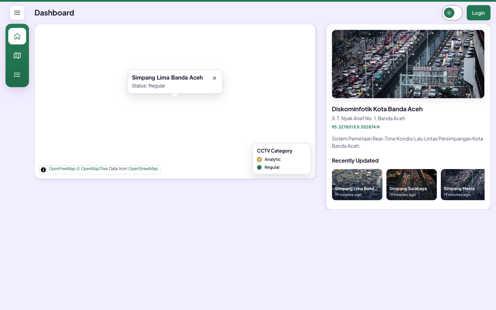

# WebGISTA — Real-Time Traffic Condition Mapping

[](https://traffic-condition-webgista.vercel.app)
[](https://doi.org/10.1063/5.0203203)
[](https://etd.usk.ac.id/search/?p=show_detail&id=97872)
[](LICENSE)

Sistem WebGIS untuk memetakan tingkat kepadatan kondisi lalu lintas di persimpangan jalan Kota Banda Aceh secara *real-time* menggunakan deteksi objek kendaraan (*computer vision*) dari aliran video CCTV dan klasifikasi **Manual Kapasitas Jalan Indonesia (MKJI / IHCM 1997)**.

Proyek ini merupakan implementasi dari penelitian skripsi di Program Studi Informatika, Fakultas MIPA, Universitas Syiah Kuala (2022) dan publikasi prosiding internasional pada *AIP Conference Proceedings* Vol. 3082 (2024).

> **PERHATIAN:** Data lalu lintas yang ditampilkan di demo bukan kondisi lalu lintas aktual Kota Banda Aceh saat ini.

---

## Tautan & Demo Langsung

- **Aplikasi Demo Live:** [https://traffic-condition-webgista.vercel.app](https://traffic-condition-webgista.vercel.app)
- **Publikasi Artikel Ilmiah (*AIP Conf. Proc.*, 2024):** [https://doi.org/10.1063/5.0203203](https://doi.org/10.1063/5.0203203)
- **Skripsi / Tugas Akhir (ETD USK):** [https://etd.usk.ac.id/search/?p=show_detail&id=97872](https://etd.usk.ac.id/search/?p=show_detail&id=97872)

Pada aplikasi demo live, akses publik tersedia untuk eksplorasi peta, tabel, detail kamera, dan simulasi deteksi video. Untuk mencoba fitur manajemen admin (`/table/add`, `/table/edit/{id}`, `/setting/{id}`, serta sinkronisasi status deteksi ke peta), Anda dapat masuk melalui halaman `/login` menggunakan akun demo:

```text
Email    : admin@webgista.test
Password : password
```

---

## Tujuan Proyek & Masalah yang Diselesaikan

Persimpangan jalan di kawasan perkotaan sering mengalami lonjakan volume kendaraan yang melebihi kapasitas ruas jalan pada jam sibuk. Di Kota Banda Aceh, kamera CCTV persimpangan telah tersedia sebagai bagian dari infrastruktur *Smart City*, tetapi akses pemantauannya masih terbatas pada kalangan pengelola tertentu sehingga pengguna jalan umum belum dapat memanfaatkan informasi kondisi lalu lintas tersebut.

**WebGISTA** menjembatani kebutuhan tersebut dengan:
1. Menghitung jumlah dan jenis kendaraan yang melintasi area pantauan (*Region of Interest*) pada aliran video CCTV langsung di sisi klien.
2. Mengonversi volume kendaraan menjadi nilai ekivalensi mobil penumpang (**smp/jam**) dan membandingkannya dengan kapasitas jalan (**MKJI 1997**) untuk menghasilkan tingkat pelayanan persimpangan (**A–F**).
3. Menyajikan status kondisi lalu lintas tersebut ke dalam peta WebGIS interaktif yang dapat diakses publik sekaligus dikelola melalui antarmuka admin.

---

## Arsitektur, Metodologi, & Teknologi

### 1. Alur Deteksi & Klasifikasi Lalu Lintas (MKJI / IHCM 1997)

```text
Aliran Video CCTV ──▶ TensorFlow.js (COCO-SSD) ──▶ Filter Poligon ROI Persimpangan
                                                            │
                                                            ▼
Visualisasi Marker Peta (/map) ◀── Klasifikasi V/C (A–F) ◀── Hitung Volume (smp/jam)
```

- **Deteksi Kendaraan di Browser:** Menggunakan `@tensorflow/tfjs` dan model pra-latih `@tensorflow-models/coco-ssd` (serta opsi mode data pra-hitung `public/demo/detections/*.json`) untuk mendeteksi kelas `car`, `truck`, `bus`, `motorcycle`, `bicycle`, dan `person` di dalam poligon ROI berwarna biru.
- **Pembobotan Ekivalensi Mobil Penumpang (EMP):**
  - Kendaraan Ringan (`LV` — `car`): bobot `1,0`
  - Kendaraan Berat (`HV` — `truck`, `bus`): bobot `1,3`
  - Sepeda Motor (`MC` — `motorcycle`, `bicycle`, `person`): bobot `0,4`
- **Kapasitas Ruas Persimpangan:** Dihitung dengan persamaan MKJI 1997 (`C = C₀ × FCw × FCsp × FCsf × FCcs`) untuk jalan perkotaan 3 lajur sebesar **`C = 1.650 × 1 × 1 × 1 × 0,90 × 3 = 4.455 smp/jam`**.
- **Jendela Evaluasi:** Penghitungan dihitung dalam jendela waktu `30 detik` untuk memetakan rasio derajat kejenuhan (`V/C`) ke 6 tingkat pelayanan jalan:

| Tingkat Pelayanan | Kategori | Rasio `V/C` | Penanda Peta |
| :---: | :--- | :---: | :---: |
| **A** | *Great* (Arus bebas) | `< 0,6` | Hijau muda |
| **B** | *Good* (Arus stabil) | `0,6 – 0,7` | Hijau |
| **C** | *Average* (Stabilitas menurun) | `0,7 – 0,8` | Kuning |
| **D** | *Poor* (Mendekati tidak stabil) | `0,8 – 0,9` | Oranye muda |
| **E** | *Bad* (Tidak stabil / padat) | `0,9 – 1,0` | Oranye |
| **F** | *Terrible* (Macet / terhambat) | `> 1,0` | Merah |

### 2. Ringkasan Evaluasi Penelitian

- **Kelayakan Usabilitas (*System Usability Scale* / SUS):** Evaluasi terhadap **20 responden** memperoleh skor **81** (**Grade B**, kategori *Excellent*), yang menunjukkan antarmuka dan alur WebGIS dapat diterima dengan baik dari sisi fungsionalitas maupun tampilan.
- **Catatan Akurasi Deteksi:** Publikasi mencatat bahwa tingkat akurasi deteksi masih terbatas ketika sudut pandang kamera CCTV lapangan kurang ideal terhadap karakteristik model pra-latih COCO-SSD.

### 3. Stack Teknologi

- **Backend:** Laravel 8 (`PHP ^8.2`), MySQL / SQLite, Sanctum & Session Authentication, Form Requests, Service Layer, API Resources.
- **Frontend:** Vue `2.6`, Laravel Mix `6` (webpack 5), Tailwind CSS `2`, Element UI `2.15`, MapLibre GL JS (OpenFreeMap / OpenTopoMap; mendukung MapTiler / Stadia melalui `.env`), Chart.js, Flickity, dan Axios.
- **Machine Learning:** `@tensorflow/tfjs` + `@tensorflow-models/coco-ssd`.

---

## Fitur Utama

1. **Dashboard (`/`):** Peta ringkasan sebaran titik kamera (*Analytic* dan *Regular*), kartu informasi instansi pengelola, serta carousel kamera terbaru.
2. **Map View (`/map`):** Peta interaktif dengan 4 gaya peta (*Street*, *Light*, *Dark*, *Outdoor*), pengatur layer titik CCTV dan batas administrasi kecamatan Kota Banda Aceh (`public/geojson/bandaacehgeojson.geojson`), bilah pencarian cepat persimpangan, serta legenda terpisah antara kondisi lalu lintas (**A–F** + *No Data*) dan kategori kamera pemantau (*Regular*).
3. **Table View (`/table`):** Daftar kamera dengan pencarian, paginasi (`5–100`), halaman detail kamera (`/detail/{id}`), halaman analisis video & editor poligon ROI (`/detail/video/{id}` untuk kamera *Analytic*), serta CRUD admin (`/table/add`, `/table/edit/{id}`).
4. **Map Settings & Profile (`/setting/{id}`, `/profile/{id}`, Admin):** Konfigurasi koordinat pusat peta, tingkat zoom default, manajemen daftar instansi, serta pembaruan profil dan kata sandi admin.

---

## Tampilan Antarmuka

| Dashboard (`1440px`) | Video Detection & ROI (`1440px` Dark) |
| --- | --- |
|  |  |

| Map View Light (`1440px`) | Map View Dark (`1440px`) |
| --- | --- |
|  |  |

---

## Panduan Instalasi & Penggunaan Lokal

### Prasyarat

- **PHP `^8.2`** (ekstensi `pdo_mysql` / `pdo_sqlite`, `mbstring`, `xml`, `bcmath`)
- **Composer**
- **Node.js `18.17.1`** atau yang sesuai pada [`.nvmrc`](.nvmrc) + **npm**
- **MySQL** (atau **SQLite** untuk pengembangan lokal ringan)

### Langkah Setup

1. **Clone repositori dan pasang dependensi:**

```bash
git clone https://github.com/moel-ihsan/webgista.git
cd webgista
composer install
npm install
```

2. **Konfigurasi lingkungan (`.env`) dan kunci aplikasi:**

```bash
cp .env.example .env
php artisan key:generate
```

Sesuaikan konfigurasi database di `.env` (buat database `webgis` bila memakai MySQL, atau ubah ke `DB_CONNECTION=sqlite`) serta kredensial demo admin (`DEMO_ADMIN_EMAIL`, `DEMO_ADMIN_PASSWORD`). Variabel `MAP_PROVIDER=auto` sudah aktif memakai OpenFreeMap & OpenTopoMap, dan dapat diisi `MAPTILER_API_KEY` atau `STADIA_API_KEY` bila ingin memakai penyedia tile alternatif.

3. **Buat symlink storage, jalankan migrasi, dan isi data awal (*seed*):**

```bash
php artisan storage:link
php artisan migrate --seed
```

4. **Kompilasi aset frontend dan jalankan server lokal:**

```bash
npm run dev
php artisan serve
```

Aplikasi dapat diakses di `http://127.0.0.1:8000`.

### Pengujian, Linter, & Build Statis

```bash
# Pengujian backend & gaya kode PHP (Laravel Pint)
php artisan test
./vendor/bin/pint --test app/Http/Controllers app/Services app/Http/Requests app/Http/Resources database/seeders tests/Feature

# Pengujian unit frontend, ESLint, & Prettier
npm run test:js
npm run lint
npm run format:check

# Build bundle statis (output ke direktori dist/)
npm run build:static
```

---

## Struktur Direktori

```text
├── app/                # Controller, Form Request, Model, API Resource, Service Layer Laravel
├── config/             # Konfigurasi aplikasi, autentikasi, peta, dan simulasi
├── database/           # Migrasi skema, factory, dan seeder titik CCTV Kota Banda Aceh
├── public/             # Aset publik, GeoJSON batas kecamatan, video demo & JSON pra-hitung
├── resources/
│   ├── css/            # Token tema (Light/Dark), gaya global, & konfigurasi Tailwind
│   ├── js/             # Halaman Vue 2, komponen peta/deteksi, layanan API, & modul MKJI 1997
│   └── views/          # Template Blade entrypoint per halaman
├── routes/             # Definisi rute web dan API
├── scripts/            # Generator artefak statis (build-static.js)
└── tests/              # Pengujian fitur Laravel (PHPUnit) dan unit test frontend (Jest)
```

---

## Panduan Kontribusi

Kontribusi untuk perbaikan bug, peningkatan akurasi deteksi, maupun pengembangan fitur baru sangat terbuka:

1. **Melaporkan Bug atau Mengajukan Fitur:** Buka [GitHub Issues](https://github.com/moel-ihsan/webgista/issues) dengan menyertakan deskripsi jelas, langkah reproduksi (jika bug), tangkapan layar, serta informasi lingkungan (`PHP`, `Node.js`, browser).
2. **Mengirim *Pull Request*:**
   - *Fork* repositori ini dan buat branch baru dari `main` (`git checkout -b feat/nama-fitur` atau `fix/nama-perbaikan`).
   - Pastikan seluruh pengujian dan pemeriksaan gaya kode lolos (`php artisan test`, `pint --test`, `npm run test:js`, `npm run lint`, `npm run format:check`).
   - Kirim *Pull Request* ke branch `main` dengan ringkasan perubahan yang terstruktur.

---

## Sitasi (*Citation*)

Apabila Anda memanfaatkan repositori, metodologi, atau temuan dari proyek ini dalam publikasi ilmiah atau pengembangan lanjutan, silakan merujuk pada kedua referensi berikut:

1. **Artikel Prosiding (*AIP Conference Proceedings*, 2024):**
   Ahmad, M. I., Affan, M., & Ardiansyah. (2024). Banda Aceh traffic conditions real-time mapping at intersections based on WebGIS and machine learning. *AIP Conference Proceedings*, 3082, 050013. https://doi.org/10.1063/5.0203203

2. **Tugas Akhir / Skripsi (Universitas Syiah Kuala, 2022):**
   Ahmad, M. I. (2022). *Pemetaan Real Time Kondisi Lalu Lintas Pada Persimpangan Jalan di Kota Banda Aceh Berbasis Web GIS dan Machine Learning* [Skripsi, Fakultas Matematika dan Ilmu Pengetahuan Alam, Universitas Syiah Kuala]. https://etd.usk.ac.id/search/?p=show_detail&id=97872

```bibtex
@inproceedings{ahmad2024banda,
  author    = {Ahmad, Maulana Ihsan and Affan, Muzailin and Ardiansyah},
  title     = {Banda Aceh Traffic Conditions Real-Time Mapping at Intersections Based on WebGIS and Machine Learning},
  booktitle = {AIP Conference Proceedings},
  year      = {2024},
  volume    = {3082},
  number    = {1},
  pages     = {050013},
  publisher = {AIP Publishing},
  doi       = {10.1063/5.0203203},
  url       = {https://doi.org/10.1063/5.0203203}
}

@misc{ahmad2022pemetaan,
  author       = {Ahmad, Maulana Ihsan},
  title        = {Pemetaan Real Time Kondisi Lalu Lintas Pada Persimpangan Jalan di Kota Banda Aceh Berbasis Web GIS dan Machine Learning},
  howpublished = {Skripsi (S1), Program Studi Informatika, Fakultas MIPA, Universitas Syiah Kuala},
  year         = {2022},
  url          = {https://etd.usk.ac.id/search/?p=show_detail&id=97872}
}
```

---

## Lisensi, Atribusi Media, & Kontak

- **Lisensi:** Kode sumber dirilis di bawah [MIT License](LICENSE).
- **Atribusi Video Simulasi:**
  - [`public/demo/videos/simpang-pdam.mp4`](public/demo/videos/simpang-pdam.mp4) diadaptasi dari [File:A intersection with traffic in Chiang Mai, Thailand.ogv](https://commons.wikimedia.org/wiki/File:A_intersection_with_traffic_in_Chiang_Mai,_Thailand.ogv) oleh **Amada44** ([CC BY-SA 4.0](https://creativecommons.org/licenses/by-sa/4.0)).
  - [`public/demo/videos/simpang-jambo-tape.mp4`](public/demo/videos/simpang-jambo-tape.mp4) diadaptasi dari [File:Changing lanes in Gothenburg ubt.ogv](https://commons.wikimedia.org/wiki/File:Changing_lanes_in_Gothenburg_ubt.ogv) oleh **Tomasz Sienicki (`User:tsca`)** ([CC BY 3.0](https://creativecommons.org/licenses/by/3.0)).
- **Kontak Pengembang:** **Maulana Ihsan Ahmad** — Program Studi Informatika, Universitas Syiah Kuala (`moel.ihsan@usk.ac.id`).
