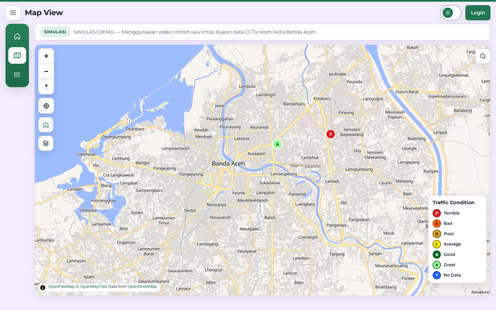
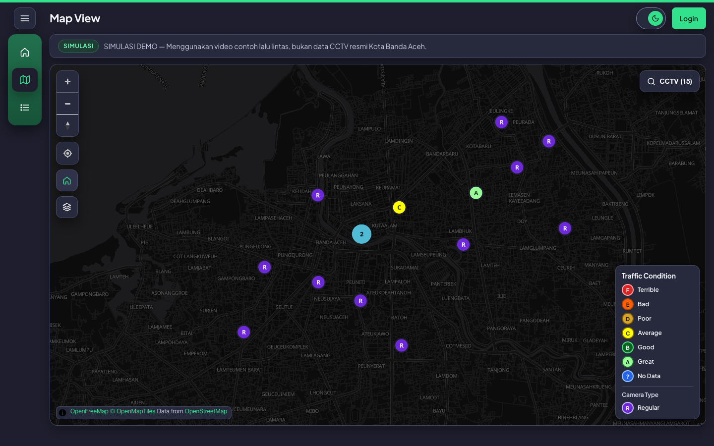
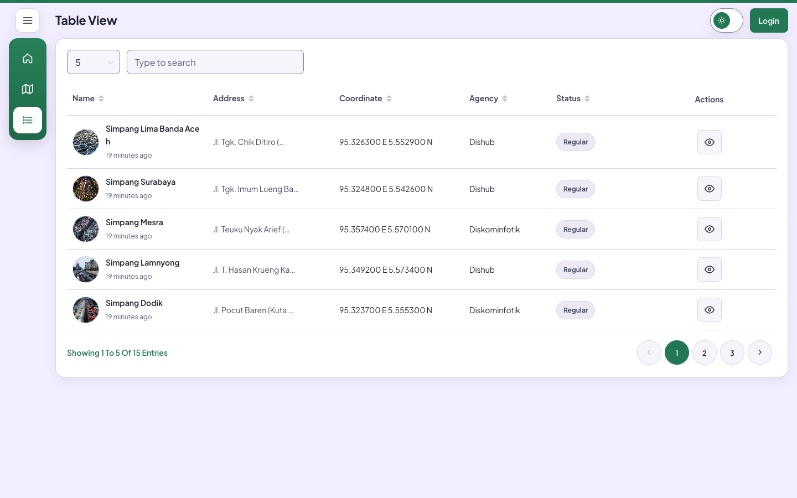
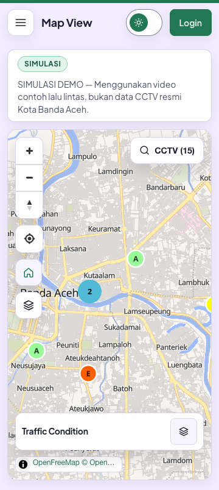

# WebGISTA — Real-Time Traffic Condition Mapping (Banda Aceh WebGIS + COCO-SSD)

> **PERHATIAN — SIMULASI DEMO:** Demo publik menggunakan **video lalu lintas contoh (simulasi)** berlisensi Creative Commons karena izin siaran langsung CCTV Kota Banda Aceh tidak lagi tersedia. Data lalu lintas yang ditampilkan di demo **bukan kondisi lalu lintas aktual Kota Banda Aceh saat ini**.

- **URL Demo Publik (Rp0):** [https://traffic-condition-webgista.vercel.app](https://traffic-condition-webgista.vercel.app)
- **Panduan Deployment & Konfigurasi:** [`docs/DEPLOY.md`](docs/DEPLOY.md)

Implementasi pemulihan dan peningkatan dari proyek riset *"Banda Aceh Traffic Conditions Real-Time Mapping at Intersections Based on WebGIS and Machine Learning"* (*AIP Conf. Proc.* 3082, 050013, 2024, doi: `10.1063/5.0203203`).

---

## Ringkasan Sistem & Stack

- **Backend:** Laravel 8 (`PHP ^8.2`), MySQL / SQLite, Form Requests, Services, API Resources, Sanctum/Session Auth + middleware `admin`
- **Frontend:** Vue `2.6.14`, Laravel Mix `6.0.34` (webpack 5, `Node 18.17.1`), Element UI `2.15.3`, MapLibre GL JS (OpenFreeMap / OpenTopoMap gratis tanpa kartu kredit; opsional MapTiler/Stadia via `.env`), Flickity, Axios
- **Deteksi Kendaraan (Client-Side, Rp0 Server Inference):**
  - Mode utama: TensorFlow.js (`@tensorflow/tfjs`) + model pra-latih `@tensorflow-models/coco-ssd` langsung di browser
  - Mode cadangan otomatis/manual: JSON pra-hitung sinkron waktu video (`public/demo/detections/*.json`)
- **Metodologi Lalu Lintas (IHCM / MKJI 1997):**
  - Kelas COCO-SSD: `car` (`LV`, bobot `1,0`), `truck`/`bus` (`HV`, bobot `1,3`), `motorcycle`/`bicycle`/`person` (`MC`, bobot `0,4`)
  - Kapasitas simpang 3 lajur: `C = 1.650 × 1 × 1 × 1 × 0,90 × 3 = 4.455 smp/jam`
  - Jendela analisis `30 detik` di-reset setiap siklus/loop, diklasifikasikan berdasar rasio `V/C` grade **A** (`< 0,6`) hingga **F** (`> 1,0`), serta diperbarui pada `Map View` lewat polling `1000 ms`.
- **Evaluasi & Catatan Kejujuran Riset:** Pada publikasi asli, evaluasi usability mencatat skor **SUS 81 (grade B, excellent, 20 responden)**, sementara akurasi deteksi diakui masih terbatas akibat sudut kamera CCTV lapangan terhadap model pra-latih COCO-SSD.

---

## Fitur & Menu

1. **Dashboard (`/`)**: Peta ringkasan sebaran CCTV (`Analytic` / `Regular`), kartu profil instansi, dan carousel pembaruan terbaru.
2. **Map View (`/map`)**: Peta interaktif MapLibre GL JS dengan 4 gaya peta (*Street*, *Light*, *Dark*, *Outdoor*), toggle layer CCTV & batas administrasi 9 kecamatan Kota Banda Aceh (`public/geojson/bandaacehgeojson.geojson`), bilah pencarian kanan, legenda kondisi A–F + `No Data`, dan pembaruan marker setiap `1000 ms`.
3. **Table View (`/table`)**: Tabel titik CCTV dengan pencarian, ukuran halaman (`5–100`), tautan detail (`/detail/{id}`), analisis video (`/detail/video/{id}` untuk kamera `Analytic`), serta CRUD admin (`/table/add`, `/table/edit/{id}`, hapus via `DELETE`).
4. **Map Settings (`/setting/{id}`, khusus admin)**: Pengaturan titik tengah & zoom peta default serta daftar instansi/agensi (`el-tag`).

---

## Tampilan Antarmuka (Light, Dark, & Responsif)

| Map View Light (`1440px`) | Map View Dark (`1440px`) |
| --- | --- |
|  |  |

| Dashboard (`1440px`) | Video Detection & ROI (`1440px` Dark) |
| --- | --- |
|  |  |

| Table View (`1440px`) | Map View Mobile (`360px`) |
| --- | --- |
|  |  |

---

## Instalasi & Menjalankan Secara Lokal

Prasyarat: **Node.js `18.17.1`** (lihat [`.nvmrc`](.nvmrc)), **PHP `^8.2`**, dan **Composer** (peta default memakai OpenFreeMap + OpenTopoMap tanpa API key maupun kartu kredit).

```bash
composer install
npm install
cp .env.example .env
php artisan key:generate
# Isi koneksi database (DB_*). MAP_PROVIDER=auto sudah aktif tanpa API key;
# opsional isi MAPTILER_API_KEY atau STADIA_API_KEY bila ingin tile vektor berkuota terkelola
php artisan migrate --seed
npm run dev
php artisan serve
```

Pengujian & linter:

```bash
./vendor/bin/phpunit
./vendor/bin/pint --test app/Http/Controllers app/Services app/Http/Requests app/Http/Resources database/seeders
npm run test:js
npm run lint
npm run format:check
npm run build:static
```

---

## Kredit Video Simulasi

- **Simpang PDAM (simulasi):** [`public/demo/videos/simpang-pdam.mp4`](public/demo/videos/simpang-pdam.mp4) diadaptasi (loop `30s`, `640x360`, H.264 tanpa audio) dari [File:A intersection with traffic in Chiang Mai, Thailand.ogv](https://commons.wikimedia.org/wiki/File:A_intersection_with_traffic_in_Chiang_Mai,_Thailand.ogv) oleh **Amada44** ([CC BY-SA 4.0](https://creativecommons.org/licenses/by-sa/4.0)).
- **Simpang Jambo Tape (simulasi):** [`public/demo/videos/simpang-jambo-tape.mp4`](public/demo/videos/simpang-jambo-tape.mp4) diadaptasi (trim `30s`, crop `640x360`, H.264 tanpa audio) dari [File:Changing lanes in Gothenburg ubt.ogv](https://commons.wikimedia.org/wiki/File:Changing_lanes_in_Gothenburg_ubt.ogv) oleh **Tomasz Sienicki (`User:tsca`)** ([CC BY 3.0](https://creativecommons.org/licenses/by/3.0) / GFDL 1.2+).

Dokumentasi teknis, deployment & UI/UX tersedia pada [`docs/ANALYSIS.md`](docs/ANALYSIS.md), [`docs/SIMULATION_DEMO.md`](docs/SIMULATION_DEMO.md), [`docs/DEPLOY.md`](docs/DEPLOY.md), [`docs/UIUX_AUDIT.md`](docs/UIUX_AUDIT.md), [`docs/DESIGN_PROPOSAL.md`](docs/DESIGN_PROPOSAL.md), [`docs/UIUX_RESULTS.md`](docs/UIUX_RESULTS.md), dan [`docs/BACKLOG.md`](docs/BACKLOG.md).
