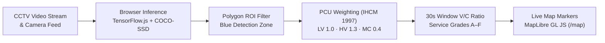
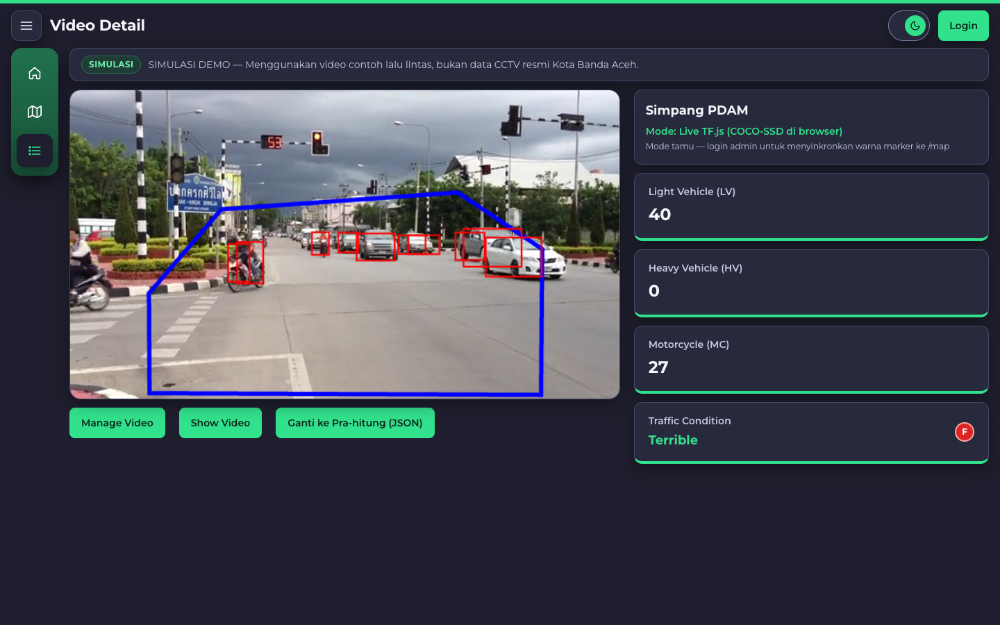

# Banda Aceh Traffic Conditions Real-Time Mapping at Intersections

[](https://traffic-condition-webgista.vercel.app)
[](https://doi.org/10.1063/5.0203203)
[](https://etd.usk.ac.id/search/?p=show_detail&id=97872)
[](LICENSE)

A WebGIS platform for mapping intersection traffic congestion levels in Banda Aceh in real time using client-side computer vision on CCTV video streams and the **1997 Indonesian Highway Capacity Manual (IHCM / MKJI)** methodology.

This repository is the implementation of an undergraduate thesis from the Informatics Department, Faculty of Mathematics and Natural Sciences, Universitas Syiah Kuala (2022), and its peer-reviewed conference article published in *AIP Conference Proceedings* Vol. 3082 (2024).

> **NOTICE:** The traffic data shown in the live demo uses sample traffic footage and does not reflect actual real-time traffic conditions in Banda Aceh.

---

## Links & Live Demo

- **Live Demo Application:** [https://traffic-condition-webgista.vercel.app](https://traffic-condition-webgista.vercel.app)
- **Research Article (*AIP Conf. Proc.*, 2024):** [https://doi.org/10.1063/5.0203203](https://doi.org/10.1063/5.0203203)
- **Undergraduate Thesis (ETD USK):** [https://etd.usk.ac.id/search/?p=show_detail&id=97872](https://etd.usk.ac.id/search/?p=show_detail&id=97872)

Public visitors can explore the dashboard, interactive map, camera table, camera details, and live browser-based video detection. To test admin workflows (`/table/add`, `/table/edit/{id}`, `/setting/{id}`, and live status synchronization to `/map`), sign in via `/login` using the demo credentials:

```text
Email    : admin@webgista.test
Password : password
```

---

## Project Objectives & Problem Statement

Urban road intersections frequently experience severe congestion during peak hours when traffic volume exceeds road segment capacity. While Banda Aceh deploys intersection CCTV cameras as part of its Smart City initiative, access to these feeds has historically been limited to municipal authorities, leaving commuters without public visibility into intersection traffic conditions.

**WebGISTA** addresses this gap by:
1. Detecting and counting vehicles crossing a configurable Region of Interest (ROI) polygon directly in the browser from CCTV video streams.
2. Converting raw vehicle counts into Passenger Car Units (**PCU/hour**) and comparing them against intersection capacity (**IHCM / MKJI 1997**) to classify Level of Service grades (**A–F**).
3. Publishing real-time spatial congestion indicators and camera statuses through a responsive WebGIS interface for both public road users and municipal administrators.

---

## Architecture, Methodology & Evaluation

### 1. Detection & Traffic Classification Pipeline (IHCM / MKJI 1997)



- **Browser-Based Vehicle Detection:** Powered by `@tensorflow/tfjs` and the pre-trained `@tensorflow-models/coco-ssd` model (with optional synchronized precomputed JSON playback in `public/demo/detections/*.json`), detecting `car`, `truck`, `bus`, `motorcycle`, `bicycle`, and `person` inside the intersection ROI polygon.
- **Passenger Car Equivalence (PCE / EMP):**
  - Light Vehicle (`LV` — `car`): `1.0`
  - Heavy Vehicle (`HV` — `truck`, `bus`): `1.3`
  - Motorcycle (`MC` — `motorcycle`, `bicycle`, `person`): `0.4`
- **Intersection Capacity:** Computed via the 1997 IHCM equation (`C = C₀ × FCw × FCsp × FCsf × FCcs`) for a 3-lane urban divided roadway as **`C = 1,650 × 1 × 1 × 1 × 0.90 × 3 = 4,455 pcu/hour`**.
- **Evaluation Window:** Vehicle counts reset every `30 seconds` to evaluate the Volume-to-Capacity ratio (`V/C`) across six Level of Service tiers:

| Grade | Traffic Condition | `V/C` Ratio | Map Indicator |
| :---: | :--- | :---: | :---: |
| **A** | Great (Free flow) | `< 0.6` | Light green |
| **B** | Good (Stable flow) | `0.6 – 0.7` | Green |
| **C** | Average (Stable, slight delay) | `0.7 – 0.8` | Yellow |
| **D** | Poor (Approaching unstable flow) | `0.8 – 0.9` | Light orange |
| **E** | Bad (Unstable / congested) | `0.9 – 1.0` | Orange |
| **F** | Terrible (Forced / breakdown) | `> 1.0` | Red |

### 2. Research Evaluation Summary

- **Usability (System Usability Scale / SUS):** Evaluated with **20 respondents**, achieving an overall score of **81** (**Grade B**, *Excellent*), confirming strong functional usability and visual clarity.
- **Detection Accuracy Note:** As reported in the published paper, automated vehicle-counting accuracy can degrade when field CCTV mounting angles deviate from standard COCO-SSD training perspectives.

### 3. Technology Stack

- **Backend:** Laravel 8 (`PHP ^8.2`), MySQL / SQLite, Sanctum & Session Authentication, Form Requests, Service Layer, API Resources.
- **Frontend:** Vue `2.6`, Laravel Mix `6` (webpack 5), Tailwind CSS `2`, Element UI `2.15`, MapLibre GL JS (OpenFreeMap / OpenTopoMap, with optional MapTiler or Stadia via `.env`), Chart.js, Flickity, and Axios.
- **Computer Vision:** `@tensorflow/tfjs` + `@tensorflow-models/coco-ssd`.

---

## Key Features

1. **Dashboard (`/`):** Overview map of monitored intersections (*Analytic* and *Regular* cameras), managing agency card, and recently updated camera carousel.
2. **Map View (`/map`):** Interactive MapLibre map with 4 base styles (*Street*, *Light*, *Dark*, *Outdoor*), toggleable CCTV and Banda Aceh district boundary layers (`public/geojson/bandaacehgeojson.geojson`), quick intersection/grade search panel, and separated legends for Traffic Condition (**A–F** + *No Data*) and Camera Type (*Regular*).
3. **Table View (`/table`):** Searchable, paginated (`5–100` rows) camera directory linking to camera details (`/detail/{id}`), live video detection + polygon ROI editor (`/detail/video/{id}`), and admin CRUD forms (`/table/add`, `/table/edit/{id}`).
4. **Map Settings & Account (`/setting/{id}`, `/profile/{id}`, `/password`, Admin):** Configurable default map center/zoom, managing agency tags, profile photo upload, and password management.

---

## Interface Gallery

| Dashboard (`1440px`) | Video Detection & ROI (`1440px` Dark) |
| --- | --- |
|  |  |

| Map View Light (`1440px`) | Map View Dark (`1440px`) |
| --- | --- |
|  |  |

---

## Local Installation & Usage

### Prerequisites

- **PHP `^8.2`** (`pdo_mysql` / `pdo_sqlite`, `mbstring`, `xml`, `bcmath`)
- **Composer**
- **Node.js `18.17.1`** (see [`.nvmrc`](.nvmrc)) + **npm**
- **MySQL** (or **SQLite** for lightweight local setup)

### Setup Steps

1. **Clone the repository and install dependencies:**

```bash
git clone https://github.com/moel-ihsan/webgista.git
cd webgista
composer install
npm install
```

2. **Configure environment variables (`.env`) and generate app key:**

```bash
cp .env.example .env
php artisan key:generate
```

Update `DB_*` in `.env` (create the `webgis` MySQL database, or switch to `DB_CONNECTION=sqlite`) along with `DEMO_ADMIN_EMAIL` and `DEMO_ADMIN_PASSWORD`. `MAP_PROVIDER=auto` works out of the box with OpenFreeMap & OpenTopoMap, or you may provide `MAPTILER_API_KEY` / `STADIA_API_KEY`.

3. **Create the storage symlink, migrate schema, and seed initial data:**

```bash
php artisan storage:link
php artisan migrate --seed
```

4. **Compile frontend assets and start the local server:**

```bash
npm run dev
php artisan serve
```

Visit `http://127.0.0.1:8000` in your browser.

### Tests, Linters & Static Build

```bash
# Backend feature tests & PHP code style (Laravel Pint)
php artisan test
./vendor/bin/pint --test app/Http/Controllers app/Services app/Http/Requests app/Http/Resources database/seeders tests/Feature

# Frontend unit tests, ESLint & Prettier
npm run test:js
npm run lint
npm run format:check

# Generate static bundle into dist/
npm run build:static
```

---

## Directory Structure

```text
├── app/                # Laravel controllers, Form Requests, models, API resources & services
├── config/             # App, auth, map provider & simulation configuration
├── database/           # Database migrations, factories & Banda Aceh CCTV seeders
├── public/             # Public assets, Banda Aceh district GeoJSON, sample videos & precomputed JSON
├── resources/
│   ├── css/            # Light/Dark theme tokens, shared styles & Tailwind config
│   ├── js/             # Vue 2 pages, map & detection components, API adapters & IHCM 1997 logic
│   └── views/          # Blade entrypoint templates per page
├── routes/             # Web and API route definitions
├── scripts/            # Static site bundle generator (build-static.js)
└── tests/              # PHPUnit feature suites and Jest unit/smoke specs
```

---

## Citation

If you reference or build upon this work in academic research, please cite the following publications:

1. **Conference Article (*AIP Conference Proceedings*, 2024):**
   Ahmad, M. I., Affan, M., & Ardiansyah. (2024). Banda Aceh traffic conditions real-time mapping at intersections based on WebGIS and machine learning. *AIP Conference Proceedings*, 3082, 050013. https://doi.org/10.1063/5.0203203

2. **Undergraduate Thesis (Universitas Syiah Kuala, 2022):**
   Ahmad, M. I. (2022). *Pemetaan Real Time Kondisi Lalu Lintas Pada Persimpangan Jalan di Kota Banda Aceh Berbasis Web GIS dan Machine Learning* [Undergraduate thesis, Faculty of Mathematics and Natural Sciences, Universitas Syiah Kuala]. https://etd.usk.ac.id/search/?p=show_detail&id=97872

```bibtex
@inproceedings{ahmad2024banda,
  author    = {Ahmad, Maulana Ihsan and Affan, Muzailin and Ardiansyah},
  title     = {Banda Aceh Traffic Conditions Real-Time Mapping at Intersections Based on WebGIS and Machine Learning},
  booktitle = {AIP Conference Proceedings},
  year      = {2024},
  volume    = {3082},
  number    = {1},
  pages     = {050013},
  publisher = {AIP Publishing},
  doi       = {10.1063/5.0203203},
  url       = {https://doi.org/10.1063/5.0203203}
}

@misc{ahmad2022pemetaan,
  author       = {Ahmad, Maulana Ihsan},
  title        = {Pemetaan Real Time Kondisi Lalu Lintas Pada Persimpangan Jalan di Kota Banda Aceh Berbasis Web GIS dan Machine Learning},
  howpublished = {Undergraduate Thesis, Informatics Department, Universitas Syiah Kuala},
  year         = {2022},
  url          = {https://etd.usk.ac.id/search/?p=show_detail&id=97872}
}
```

---

## License, Media Attribution & Contact

- **License:** Released under the [MIT License](LICENSE).
- **Sample Video Attribution:**
  - [`public/demo/videos/simpang-pdam.mp4`](public/demo/videos/simpang-pdam.mp4) adapted from [File:A intersection with traffic in Chiang Mai, Thailand.ogv](https://commons.wikimedia.org/wiki/File:A_intersection_with_traffic_in_Chiang_Mai,_Thailand.ogv) by **Amada44** ([CC BY-SA 4.0](https://creativecommons.org/licenses/by-sa/4.0)).
  - [`public/demo/videos/simpang-jambo-tape.mp4`](public/demo/videos/simpang-jambo-tape.mp4) adapted from [File:Changing lanes in Gothenburg ubt.ogv](https://commons.wikimedia.org/wiki/File:Changing_lanes_in_Gothenburg_ubt.ogv) by **Tomasz Sienicki (`User:tsca`)** ([CC BY 3.0](https://creativecommons.org/licenses/by/3.0)).
- **Author & Contact:** **Maulana Ihsan Ahmad** — Informatics Department, Universitas Syiah Kuala (`moel.ihsan@usk.ac.id`).
