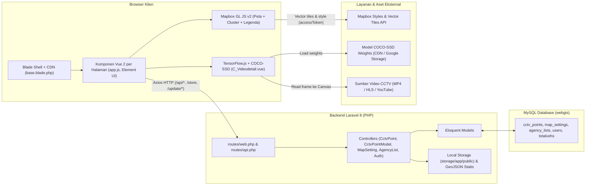
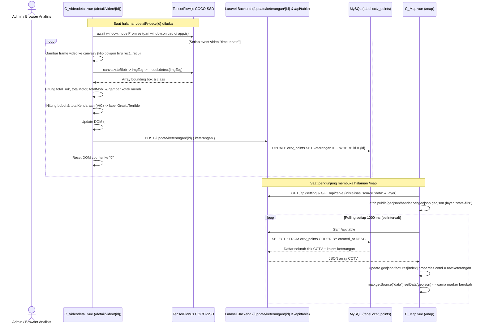

# Analisis Sistem WebGISTA v1 (`v1-restore`)

> **Baseline:** Branch `v1-restore` pada commit `45c44d0e3df263b7b7144a6d24ca71a71083af2f` (`2025-12-05`).
> **Sumber kebenaran fungsionalitas:** [artikelwebgis.md](file:///Users/moel_04/work/ta_webgis/artikelwebgis.md) — *"Banda Aceh Traffic Conditions Real-Time Mapping at Intersections Based on WebGIS and Machine Learning"*, Maulana Ihsan Ahmad, Muzailin Affan, Ardiansyah (*AIP Conf. Proc.* 3082, 050013, 2024, DOI: `10.1063/5.0203203`).

---

## 1. Ringkasan & Tujuan Proyek

WebGISTA (*WebGIS Traffic Analytics*) adalah aplikasi web untuk memetakan tingkat kepadatan lalu lintas di persimpangan jalan Kota Banda Aceh secara *real-time* berdasarkan video CCTV menggunakan *object detection* di browser dan metode **Manual Kapasitas Jalan Indonesia (MKJI / IHCM) 1997**.

- **Pendekatan teknis utama:** Inferensi *machine learning* (TensorFlow.js + model pra-latih COCO-SSD) dijalankan langsung di browser klien untuk mendeteksi dan menghitung kendaraan dari feed video, menghitung rasio volume terhadap kapasitas ($V/C$), mengklasifikasikan tingkat pelayanan jalan (kelas **A–F**), lalu memperbarui status ke basis data dan memvisualisasikannya sebagai warna titik CCTV pada peta WebGIS (Mapbox GL JS).
- **Temuan evaluasi asli (dari artikel):** Pengujian kelayakan menggunakan *System Usability Scale* (SUS) terhadap 20 responden menghasilkan skor **81** (kategori *EXCELLENT*, *Grade B*). Artikel menyatakan secara jujur bahwa akurasi perhitungan kondisi lalu lintas masih kurang baik karena sudut/posisi kamera CCTV tidak cocok untuk algoritma deteksi yang digunakan.
- **Klarifikasi ruang lingkup dari pemilik proyek:**
  - Artikel [artikelwebgis.md](file:///Users/moel_04/work/ta_webgis/artikelwebgis.md) menjadi acuan utama fungsionalitas.
  - Versi Mapbox GL JS v2 dipertahankan sesuai implementasi v1.
  - Data batas 9 kecamatan Kota Banda Aceh pada [bandaacehgeojson.geojson](file:///Users/moel_04/work/ta_webgis/public/geojson/bandaacehgeojson.geojson) telah memiliki izin publikasi.

---

## 2. Stack Teknologi Lengkap (Diverifikasi dari Kode & Lockfile)

### A. Runtime Lingkungan Lokal (Terverifikasi di Fase 1)

| Komponen | Versi Terpasang Lokal | Deklarasi di Repo | Status & Catatan Verifikasi |
| :--- | :--- | :--- | :--- |
| **PHP** | `8.2.4` (`/Applications/XAMPP/xamppfiles/bin/php`) | `"php": "^8.2.8"` ([composer.json](file:///Users/moel_04/work/ta_webgis/composer.json)) | `composer check-platform-reqs` & `php artisan` diblokir oleh `vendor/composer/platform_check.php` pada `8.2.4`; berjalan normal jika platform check dilewati (`--ignore-platform-req=php`), karena seluruh paket di `composer.lock` hanya mensyaratkan `^7.x|^8.0` / `>=8.1`. |
| **Composer** | `2.5.8` | — | Terpasang lokal. |
| **Node.js** | `v18.17.1` (`/usr/local/bin/node`), `v26.7.0` (`/opt/homebrew/bin/node`), serta `v21.1.0` di parent `/Users/moel_04/node_modules/node` | Tidak ada `.nvmrc` | Build webpack 5 gagal dengan `ERR_OSSL_EVP_UNSUPPORTED` tanpa `NODE_OPTIONS=--openssl-legacy-provider`. Dengan flag tersebut, `v18.17.1`, `v21.1.0`, dan `v26.7.0` sukses mengompilasi aset via Laravel Mix. |
| **Database** | MySQL (`.env`: `127.0.0.1:3306`, DB `webgis`), SQLite 3 (`/usr/bin/sqlite3`) | `mysql` ([.env.example](file:///Users/moel_04/work/ta_webgis/.env.example), [database.php](file:///Users/moel_04/work/ta_webgis/config/database.php)) | XAMPP MySQL lokal tidak aktif (`Connection refused`); seluruh 12 migrasi, seeder, dan 13 rute teruji berjalan HTTP 200 dengan SQLite. |

### B. Dependensi Backend (`composer.json` & `composer.lock`)

| Paket | Deklarasi (`composer.json`) | Terkunci (`composer.lock`) | Peran di v1 |
| :--- | :--- | :--- | :--- |
| `laravel/framework` | `^8.0` | `v8.83.27` | Framework backend MVC, routing, Eloquent ORM, Blade SSR |
| `laravel/jetstream` | `^1.4` | `v1.7.2` | Scaffolding auth/profile/team (sebagian view/rute bawaan masih terdaftar) |
| `laravel/fortify` | (transitif Jetstream) | `v1.17.4` | Mendaftarkan rute auth Fortify (`/forgot-password`, `/user/*`, dll.) |
| `laravel/sanctum` | `^2.6` | `v2.15.1` | Terpasang (`HasApiTokens` di `User`), middleware `auth:sanctum` dikomentari di rute |
| `laravel/ui` | `^3.2` | `v3.4.6` | Scaffolding Auth controller lama di `app/Http/Controllers/Auth/` (tidak dipakai rute aktif) |
| `livewire/livewire` | `^2.0` | `v2.12.6` | Terpasang bersama Jetstream (rute `livewire/*` otomatis aktif) |
| `doctrine/dbal` | `^3.1` | `3.6.5` | Dukungan skema DB migrasi |
| `guzzlehttp/guzzle` | `^7.0.1` | `7.7.0` | HTTP client PHP |
| `fruitcake/laravel-cors` | `^2.0` | `v2.2.0` | Middleware CORS global |
| `fideloper/proxy` | `^4.2` | `4.4.2` | Trusted proxy middleware |
| `fzaninotto/faker` | `^1.9` | `dev-master` | Factory data dummy (archived/deprecated) |
| `phpunit/phpunit` | `^9.3` (dev) | `9.6.10` | Test runner PHPUnit (hanya berisi contoh bawaan Laravel) |

### C. Dependensi Frontend (`package.json`, `package-lock.json`, dan CDN di `base.blade.php`)

| Paket / Library | Deklarasi (`package.json`) | Terkunci (`package-lock.json`) | Versi CDN di [base.blade.php](file:///Users/moel_04/work/ta_webgis/resources/views/layouts/base.blade.php) | Peran & Catatan |
| :--- | :--- | :--- | :--- | :--- |
| `vue` | `^2.6.12` | `2.6.14` | — | UI komponen Vue 2 (EOL per Desember 2023) |
| `vue-template-compiler` & `vue-loader` | `^2.6.12` / `^15.9.7` | `2.6.14` / `15.9.8` | — | Kompilasi SFC `.vue` |
| `laravel-mix` & `webpack` | `^6.0.25` / `^5.52.1` | `6.0.34` / `5.52.1` | — | Bundler JS/CSS ([webpack.mix.js](file:///Users/moel_04/work/ta_webgis/webpack.mix.js)) |
| `element-ui` | `^2.15.0` | `2.15.3` | — | Library komponen UI utama (menu, tabel, form, dialog, tag, switch, popover) |
| `tailwindcss` & `@tailwindcss/ui` | `^2.2.4` / `^0.5.0` | `2.2.4` / `0.5.0` | — | **Catatan:** plugin Tailwind tidak dimasukkan ke `postCss(..., [])` di `webpack.mix.js`, sehingga [app.css](file:///Users/moel_04/work/ta_webgis/public/css/app.css) hanya berisi 64 byte directive `@tailwind` mentah |
| `bootstrap`, `jquery`, `popper.js` | `^4.0.0`, `^3.2`, `^1.12` | `4.6.0`, `3.6.0`, `1.16.1` | Bootstrap `4.5.2`, jQuery `3.5.1`, Popper `1.16.1` | Dimuat ganda (di bundle `bootstrap.js` dan via CDN `base.blade.php`) |
| `mapbox-gl` | `^2.0.1` | `2.3.1` | `v2.5.1` (JS & CSS) | Peta interaktif & clustering GeoJSON |
| `mapbox-gl-vue`, `mapbox-gl-plugin-layer-group` | `^2.0.4`, `^0.1.0` | `2.0.4`, `0.1.0` | — | Terpasang di `package.json`, tidak diimpor di komponen mana pun |
| `@tensorflow/tfjs` | `^3.11.0` | `3.11.0` | `@tensorflow/tfjs` (tanpa pin versi, **dimuat 2 kali** di baris 156 & 159!) | Runtime ML di browser (`app.js` juga me-require backend CPU & WebGL) |
| `@tensorflow-models/coco-ssd` | `^2.2.2` | `2.2.2` | `@tensorflow-models/coco-ssd` (tanpa pin versi) | Model deteksi objek 80 kelas; dimuat lewat `window.modelPromise = cocoSsd.load()` |
| `chart.js` & `vue-chartjs` | `^2.9.4` / `^3.5.1` | `2.9.4` / `3.5.1` | — | Diimpor di [LineChart.js](file:///Users/moel_04/work/ta_webgis/resources/js/components/LineChart.js) & [GraphVehicle.vue](file:///Users/moel_04/work/ta_webgis/resources/js/components/GraphVehicle.vue), **tidak dirender di halaman aktif** |
| `flickity` & `vue-flickity` | `^2.2.2` / `^1.2.1` | `2.2.2` / `1.2.1` | — | Carousel *Recently Updated* di [CardRecent.vue](file:///Users/moel_04/work/ta_webgis/resources/js/components/CardRecent.vue) |
| `axios` | `^0.21.1` | `0.21.4` | — | HTTP client di semua komponen Vue |
| Video.js + `videojs-youtube` | — | — | `7.12.0` + `2.6.1` (cdnjs) | Dimuat di `base.blade.php` untuk elemen `<video id="my-video">` |
| Ionicons & Google Fonts (`Montserrat`) | — | — | `5.4.0` (unpkg) & Google Fonts | Ikon navigasi/aksi dan tipografi utama |

---

## 3. Arsitektur & Alur Data End-to-End

### A. Arsitektur Sistem (`v1-restore`)



### B. Alur Data Real-Time End-to-End (Deteksi -> DB -> Peta)



---

## 4. Inventaris Lengkap Sistem

### A. Daftar Halaman & Komponen Vue

Semua halaman dirender via Blade (`resources/views/layouts/base.blade.php`) yang me-mount root `<div id="app">` berisi komponen container Vue yang sesuai:

| Route | Blade View | Container Vue | Komponen Utama | Fungsi | Pembatasan Peran (Aktual) |
| :--- | :--- | :--- | :--- | :--- | :--- |
| `/` | `home.blade.php` | `Dashboard.vue` | `SideBar`, `Header`, `C_Main`, `CardInfoCCTV`, `CardProfilOffice`, `CardRecent` | Halaman utama: peta auto-fly CCTV (non-interaktif, legenda kategori `Analytic`/`Regular`), profil instansi (`User::first()`), carousel *Recently Updated* | Terbuka untuk publik (`user` & `admin`) |
| `/map` | `map.blade.php` | `Mapview.vue` | `SideBar`, `Header`, `C_Map` | Peta interaktif real-time: polling 1000 ms, legenda kondisi `Terrible`–`Great` + `No Data`, pemilih gaya peta, toggle layer CCTV & batas kecamatan Banda Aceh, sidebar pencarian kanan, popup video/gambar | Terbuka untuk publik (`user` & `admin`) |
| `/table` | `table.blade.php` | `Tableview.vue` | `SideBar`, `Header`, `C_Table` | Tabel daftar CCTV dengan pencarian, paginasi klien (5/10/20/50/100), tombol aksi view, edit, hapus | Publik bisa melihat; tombol *Add New*, Edit, Delete disembunyikan di UI jika `role != 'admin'` |
| `/table/add` | `add.blade.php` | `Add.vue` | `SideBar`, `Header`, `C_Add` | Form tambah titik CCTV (koordinat klik peta, pilihan agensi, upload thumbnail, URL bila `Analytic`) | **Tanpa proteksi backend** (siapa pun bisa akses URL langsung) |
| `/table/edit/{id}` | `edit.blade.php` | `Edit.vue` | `SideBar`, `Header`, `C_Edit` | Form ubah data dan gambar titik CCTV | **Tanpa proteksi backend** |
| `/detail/{id}` | `detail.blade.php` | `Detail.vue` | `SideBar`, `Header`, `C_Detail` | Detail CCTV: video MP4 (jika `Analytic`) atau gambar (jika `Regular`), kartu metadata, peta lokasi | Publik (`user` & `admin`) |
| `/detail/video/{id}` | `videodetail.blade.php` | `Videodetail.vue` | `C_Videodetail` | Halaman pemutar video + canvas deteksi COCO-SSD + penghitung LV/HV/MC + pengirim `keterangan` ke DB | **Tanpa proteksi backend** dan **tidak ada tautan dari UI** |
| `/setting/{id}` | `setting.blade.php` | `Settings.vue` | `SideBar`, `Header`, `C_Settings` | Pengaturan titik tengah peta (`lattitude`, `longitude`, `zoom`) + pengelolaan daftar agensi (`el-tag`) | Menu disembunyikan di `SideBar.vue` bila `role != 'admin'`, tetapi **rute & endpoint tanpa middleware auth** |
| `/login` | `login.blade.php` | `Login.vue` | `C_Login` | Halaman login admin (email + password) | Publik |
| `/register` | `register.blade.php` | `Register.vue` | `C_Register` | Form register UI statis (`onSubmit` hanya `console.log("submit!")`) | Publik (dead UI) |
| `/profile/{id}` | `profile.blade.php` | `Profile.vue` | `SideBar`, `Header`, `C_Profile` | Edit profil & foto instansi/admin | **Tanpa proteksi backend** |
| `/password` | `password.blade.php` | `Password.vue` | `SideBar`, `Header`, `C_Password` | Ganti password user login | **Tanpa proteksi backend** (ID diambil dari `/authUser`) |

**File view/komponen tidak terpakai (*orphaned/dead*):** `dashboard.blade.php`, `selamat.blade.php`, `CardVehicle.vue`, `GraphVehicle.vue`, `LineChart.js` (data bulanan hardcode `[40, 39, 100, ...]`), `SearchCard.vue` (seluruh isi `<script>` dikomentari), `NavTop.vue` (template contoh Element UI).

### B. Daftar Endpoint Web & API

Didefinisikan di [routes/web.php](file:///Users/moel_04/work/ta_webgis/routes/web.php) dan [routes/api.php](file:///Users/moel_04/work/ta_webgis/routes/api.php) (tanpa middleware `auth` pada seluruh rute aplikasi inti):

| Method | URI | Controller @ Method | Group / Middleware | Deskripsi & Catatan |
| :--- | :--- | :--- | :--- | :--- |
| `GET` | `/` | Closure (`view('home')`) | `web` | Render halaman Dashboard |
| `GET` | `/map` | Closure (`view('map')`) | `web` | Render halaman Map View |
| `GET` | `/table` | `CctvPointController@index` | `web` | Render halaman Table View |
| `GET` | `/table/add` | Closure (`view('add')`) | `web` | Render form tambah CCTV |
| `GET` | `/table/edit/{cctvPoint}` | `CctvPointModelController@edit` | `web` | Render form edit CCTV |
| `GET` | `/detail/{cctvPoint}` | `CctvPointModelController@show` | `web` | Render detail CCTV |
| `GET` | `/detail/video/{cctvPoint}` | `CctvPointModelController@showvideo` | `web` | Render halaman deteksi video CCTV |
| `GET` | `/setting/{mapSetting}` | `MapSettingController@edit` | `web` | Render halaman Map Settings |
| `GET` | `/login` | `AuthController@login` | `web` | Render halaman Login |
| `POST` | `/login/enter` | `AuthController@auth` | `web` | Autentikasi `Auth::attempt`, balikan `{ status, isAuth }` |
| `GET` | `/logout` | `AuthController@logout` | `web` | Logout & redirect ke `/` |
| `GET` | `/register`, `/password` | Closure (`view(...)`) | `web` | Render halaman register/ubah password |
| `GET` | `/profileUser` | `AuthController@init` | `web` | Mengembalikan `User::first()` **tanpa login** |
| `GET` | `/authUser` | `AuthController@authUser` | `web` | Mengembalikan `Auth::guard('web')->user()` (`null` jika tamu) |
| `GET` | `/profile/{user}` | `AuthController@edit` | `web` | Render halaman edit profil user |
| `PATCH` | `/updateProfile/{user}` | `AuthController@update` | `web` | Update profil user (**tanpa cek kepemilikan/auth**) |
| `POST` | `/uploadEditProfile/{user}` | `AuthController@uploadEdit` | `web` | Upload foto profil user (**tanpa auth & tanpa validasi MIME/ukuran**) |
| `POST` | `/changePassword/{user}` | `AuthController@changePassword` | `web` | Ubah password user (**tanpa auth**, ada bug `Auth::attempt` pakai hash password) |
| `GET` | `/api/table` | `CctvPointController@table_api` | `web` | JSON semua `CctvPoint::latest()->get()` |
| `POST` | `/update/keterangan/{cctvPoint}` | `CctvPointController@update_keterangan` | `web` | Update kolom `keterangan` CCTV (**tanpa auth**) |
| `POST` | `/store` | `CctvPointModelController@store` | `web` | Simpan CCTV baru + pindahkan `tmp.jpg` (**tanpa auth**) |
| `PATCH` | `/update/{cctvPoint}` | `CctvPointModelController@update` | `web` | Update CCTV (**tanpa auth**; mengisi `keterangan = 'Low'` jika `url` ada) |
| `POST` | `/upload` | `CctvPointModelController@upload` | `web` | Upload gambar sementara ke `public/cctv/image/tmp.jpg` (**tanpa auth/validasi**) |
| `POST` | `/uploadEdit/{cctvPoint}` | `CctvPointModelController@uploadEdit` | `web` | Upload gambar edit CCTV (**tanpa auth/validasi**) |
| `GET` | `/destroy/{cctvPoint}` | `CctvPointModelController@destroy` | `web` | Hapus CCTV via **`GET`** (**anti-pattern HTTP & tanpa auth**) |
| `GET` | `/api/agency` | `AgencyListController@table_agency` | `web` | JSON semua `AgencyList` |
| `POST` | `/store/agency` | `AgencyListController@store` | `web` | Tambah nama agensi (**tanpa auth**) |
| `GET` | `/destroyAgent/{agencyList:agency}` | `AgencyListController@destroy` | `web` | Hapus agensi via **`GET`** (**tanpa auth**) |
| `GET` | `/api/setting` | `MapSettingController@table_setting` | `web` | JSON semua `MapSetting::latest()->get()` |
| `POST` | `/store/mapSetting` | `MapSettingController@store` | `web` | Simpan map setting baru (**tanpa auth**) |
| `PATCH` | `/updateSetting/{mapSetting}` | `MapSettingController@update` | `web` | Update koordinat center & zoom peta (**tanpa auth**) |
| `POST` | `/api/traffic/{cctvPoint}` | `CctvPointController@update_keterangan` | `api` (`60 req/min`) | Endpoint API alternatif update `keterangan` (**tanpa `auth:sanctum`**) |
| `GET` | `/api/detail/{cctvPoint}` | `CctvPointModelController@showCCTV` | `api` (`60 req/min`) | Mengembalikan string `url` stream CCTV |

> **Catatan tambahan:** Rute bawaan Laravel Fortify (`/forgot-password`, `/reset-password`, `/user/profile-information`, `/user/password`, `/user/two-factor-*`) dan Livewire (`/livewire/*`) juga ikut aktif secara otomatis meskipun tidak digunakan oleh antarmuka Vue.

### C. Model & Skema Tabel Database

Total terdapat **12 file migrasi**; 5 tabel domain utama dan 7 tabel infrastruktur Laravel/Jetstream:

| Tabel & Model | Kolom Utama (`database/migrations/`) | Catatan & Temuan |
| :--- | :--- | :--- |
| **`cctv_points`** ([CctvPoint.php](file:///Users/moel_04/work/ta_webgis/app/Models/CctvPoint.php)) | `id`, `name`, `category`, `address`, `lattitude` *(typo `tt`)*, `longitude`, `agency`, `keterangan`, `path_image`, `url`, `timestamps` | Semua kolom bertipe `string` NOT NULL. **Bug skema:** `CctvPointModelController` mengisi `url = null` untuk CCTV non-analitik (`Regular`), yang berisiko gagal `NOT NULL constraint` pada MySQL strict / SQLite saat menyimpan tanpa URL. Selain itu, kolom `rec1x`..`rec5y` yang dibaca `C_Videodetail.vue` **tidak ada di tabel ini**. |
| **`map_settings`** ([MapSetting.php](file:///Users/moel_04/work/ta_webgis/app/Models/MapSetting.php)) | `id`, `lattitude`, `longitude`, `zoom`, `timestamps` | Semua bertipe `string`. **Tidak ada seeder default**; jika kosong, `/`, `/map`, dan `/setting/1` akan gagal/404. |
| **`agency_lists`** ([AgencyList.php](file:///Users/moel_04/work/ta_webgis/app/Models/AgencyList.php)) | `id`, `agency` (`string`), `timestamps` | Tidak ada seeder meskipun [AgencyListSeeder.php](file:///Users/moel_04/work/ta_webgis/database/seeders/AgencyListSeeder.php) ada (kosong). |
| **`users`** ([User.php](file:///Users/moel_04/work/ta_webgis/app/Models/User.php)) | `id`, `name`, `email` (`unique`), `password`, `email_verified_at`, `address`, `lattitude`, `longitude`, `description`, `profile_photo_path`, `role`, `two_factor_secret`, `two_factor_recovery_codes`, `remember_token`, `timestamps` | Menyimpan profil kantor/admin utama yang ditampilkan di Dashboard (`User::first()`). [UserFactory.php](file:///Users/moel_04/work/ta_webgis/database/factories/UserFactory.php) mengisi email pribadi pemilik & password `'gas'`. |
| **`totalvehs`** ([Totalveh.php](file:///Users/moel_04/work/ta_webgis/app/Models/Totalveh.php)) | `id`, `totalcar` (`integer`), `totalmotor` (`integer`), `timestamps` | Model kosong tanpa `$fillable` dan controller `TotalvehController` tidak dihubungkan ke rute mana pun (tabel mati). |
| **Tabel bawaan Laravel/Jetstream (7 migrasi)** | `password_resets`, `failed_jobs`, `personal_access_tokens`, `teams`, `team_user`, `sessions` | Bawaan template Laravel Jetstream/Sanctum, tidak dipakai fitur inti WebGISTA. |

### D. Struktur Data GeoJSON

1. **Batas Administrasi Kecamatan (Statis):** [public/geojson/bandaacehgeojson.geojson](file:///Users/moel_04/work/ta_webgis/public/geojson/bandaacehgeojson.geojson) (`295 KB`).
   - Tipe: `FeatureCollection` berisi **9 fitur** (`id`: `1`–`9`) bertipe geometri `MultiPolygon` untuk 9 kecamatan Kota Banda Aceh: *Baiturrahman* (416,19 ha), *Banda Raya* (521,24 ha), *Jaya Baru* (359,26 ha), *Kuta Alam* (921,75 ha), *Kuta Raja* (349,02 ha), *Lueng Bata* (434,04 ha), *Meuraxa* (795,84 ha), *Syiah Kuala* (1321,21 ha), dan *Ulee Kareeng* (498,1 ha).
   - Properti tiap fitur: `{ "Kabupaten": "KOTA BANDA ACEH", "KECAMATAN": "Kecamatan ...", "Luas": <float>, "kec": null }`.
   - Digunakan oleh [C_Map.vue](file:///Users/moel_04/work/ta_webgis/resources/js/components/C_Map.vue#L611-L697) pada source `"bandaaceh"` dan layer `"state-fills"` (pewarnaan interpolasi berdasarkan properti `Luas` + overlay hover `KECAMATAN` & `Luas`).
2. **Titik Sebaran CCTV (Dinamis di Browser):**
   - Dibentuk di `mounted()` pada [C_Map.vue](file:///Users/moel_04/work/ta_webgis/resources/js/components/C_Map.vue#L403-L440) dan [CardInfoCCTV.vue](file:///Users/moel_04/work/ta_webgis/resources/js/components/CardInfoCCTV.vue#L128-L166) dari `GET /api/table` sebagai `FeatureCollection` `Point` (`coordinates: [row.longitude, row.lattitude]`).
   - Properti di `C_Map.vue`: `{ pointID, description, traffic, cond }` (`cond` berisi nilai `row.keterangan`, dipakai oleh layer `"unclustered-point"`).

### E. Modul Deteksi & Rumus Konversi $V$ ke `smp/jam` (Apa Adanya di Kode)

1. **Inisialisasi Model ([resources/js/app.js](file:///Users/moel_04/work/ta_webgis/resources/js/app.js#L112-L119)):**
   ```js
   window.onload = () => (window.modelPromise = cocoSsd.load());
   ```
2. **Pipeline Canvas & Deteksi ([C_Videodetail.vue](file:///Users/moel_04/work/ta_webgis/resources/js/components/C_Videodetail.vue#L256-L441)):**
   - Memakai 4 `<canvas>`: `canvasx` (menampilkan outline area biru), `canvasv` (sumber frame yang di-`clip()` ke area poligon `rec1`–`rec5` + digambari kotak merah `result.bbox` per objek terdeteksi), `canvasy` (lapisan video dasar), `canvasw` (canvas preview tersembunyi).
   - Pada setiap event `timeupdate` elemen `<video>`: frame digambar ke canvas, `canvasv.toBlob(..., "image/jpeg")` dikonversi ke ``, lalu diproses `await model.detect(imgTag)`.
3. **Rumus Asli di Kode (`C_Videodetail.vue` baris 367–409):**
   ```js
   bobotTruk = totalTruk * 0.13;
   bobotMobil = totalMobil * 0.1;
   bobotMotor = totalMotor * 0.04;
   totalKendaraan = (bobotTruk + bobotMobil + bobotMotor) / (4455 / 3600);
   ```
   - **Cara kode mengonversi volume vs kapasitas:**
     - Kapasitas simpang 3 lajur per jam dari artikel adalah $C = 3 \times (1650 \times 1 \times 1 \times 1 \times 0{,}90) = 4455\text{ smp/jam}$.
     - Kode membagi $4455$ dengan $3600$ menjadi kapasitas **per detik** ($4455 / 3600 = 1{,}2375\text{ smp/detik}$), lalu mengalikan jumlah kendaraan pada snapshot frame saat itu dengan faktor $0{,}1\times$ bobot IHCM (`0.13`, `0.1`, `0.04` alih-alih `1.3`, `1.0`, `0.4`).
     - **Tidak ada timer/akumulator 30 detik di `C_Videodetail.vue`:** setiap panggilan `toBlob` mereset DOM counter `#result-truck`, `#result-motor`, `#result-car` kembali ke `"0"`, sehingga angka yang dihitung adalah jumlah kendaraan dalam **1 frame snapshot `timeupdate`**, bukan total kendaraan selama rentang 30 detik. *(Catatan historis: kode yang dikomentari di [C_Detail.vue](file:///Users/moel_04/work/ta_webgis/resources/js/components/C_Detail.vue#L161-L172) pernah mencoba variabel `intervalSecond == 100` dengan log `"total 10 detik"`, namun tidak pernah diaktifkan di `C_Videodetail.vue`.)*
   - **Klasifikasi di kode (`C_Videodetail.vue` baris 374–409):**
     - `totalKendaraan <= 0.6` → `"Great"`
     - `totalKendaraan > 0.6 && totalKendaraan <= 0.7` → `"Good"`
     - `totalKendaraan > 0.7 && totalKendaraan <= 0.8` → `"Average"`
     - `totalKendaraan > 0.8 && totalKendaraan <= 0.9` → `"Poor"`
     - `totalKendaraan > 0.9 && totalKendaraan <= 1` → `"Bad"`
     - `totalKendaraan > 1` → `"Terrible"`

---

## 5. Selisih (Gap) antara Kode v1 dan Artikel

| No | Aspek | Spesifikasi di Artikel ([artikelwebgis.md](file:///Users/moel_04/work/ta_webgis/artikelwebgis.md)) | Implementasi Aktual di Kode `v1-restore` | Dampak |
| :---: | :--- | :--- | :--- | :--- |
| 1 | **Filter Kelas COCO-SSD** | Hanya 5 kelas kendaraan darat: `bicycle`, `car`, `motorcycle`, `bus`, `truck`; kelas lain diabaikan. | `trucks = ["truck", "bus"]`, `bikes = ["person", "motorcycle", "bicycle"]`, dan `else if (cars)` dengan `const cars = "car"` (selalu *truthy*). | Pejalan kaki (`person`) terhitung sebagai motor; **semua objek non-kendaraan** (pohon, lampu lalu lintas, tas, dll.) terhitung sebagai mobil (`LV`)! |
| 2 | **Rentang 30 Detik & Rumus IHCM** | Hitungan mulai dari 0 tiap ganti capture, analisis pada rentang 30 detik; bobot smp `1,0` (LV), `1,3` (HV), `0,4` (MC); kapasitas total `4.455 smp/jam`. | Berjalan tiap event `timeupdate` (per frame), memakai bobot `0.1`, `0.13`, `0.04`, lalu dibagi `4455 / 3600`. | Perilaku waktu analisis dan skala bobot berbeda 10x dari formula MKJI/IHCM 1997 di artikel (faktor `0.1` pada bobot menghasilkan ekuivalensi tak langsung terhadap 10 detik jika dikaitkan kapasitas per detik, namun tanpa jendela waktu 30 detik yang konsisten). |
| 3 | **Ambang Kelas A** | `A (great) < 0,6`. | `totalKendaraan <= 0.6` → `"Great"`. | Nilai tepat `0.6` masuk ke `A` alih-alih `B`. |
| 4 | **Area Deteksi ROI (Garis Biru)** | Ada area deteksi garis biru di frame video. | `C_Videodetail.vue` menggambar poligon dari `this.cctv.rec1x`..`rec5y`, tetapi kolom tersebut **tidak ada** di tabel/migrasi `cctv_points` (bernilai `undefined`), plus typo `rec4x` sebagai koordinat Y di baris 276, 287, 300. | Saat `undefined`, `moveTo`/`lineTo`/`clip()` menggambar area `(0, 0)` sehingga tidak ada area deteksi valid yang terbentuk. |
| 5 | **Navigasi ke Halaman Deteksi** | Halaman analisis video menjadi bagian alur sistem. | Route `/detail/video/{id}` ada, tetapi **tidak ada tombol/tautan** di `C_Table.vue` atau `C_Detail.vue` untuk membukanya; kode deteksi di `C_Detail.vue` dikomentari. | Pengguna/admin harus mengetik URL `/detail/video/{id}` secara manual. |
| 6 | **Status Awal / Update CCTV** | Warna marker mengikuti A–F (`Great`–`Terrible`) atau `No Data`. | `CctvPointModelController::update()` (baris 120) mengisi `$valid['keterangan'] = 'Low'` saat `url` diisi; `'Low'` tidak ada dalam ekspresi `match` di `C_Map.vue`. | Marker jatuh ke warna default biru (`#0000FF` / `No Data`) setelah CCTV di-edit sampai deteksi berjalan lagi. |
| 7 | **Otorisasi Peran Admin & User** | Menu Map Settings khusus admin; terdapat peran admin dan user. | Role hanya dicek di komponen Vue (`v-if="role == 'admin'"`). Semua endpoint tulis/hapus/settings di `routes/web.php` & `routes/api.php` tidak punya middleware auth/role. | Tamu tanpa login bisa mengakses `/setting/1`, `/table/add`, dan mengirim request CRUD/ubah password langsung ke server. |
| 8 | **Kualitas & Stabilitas Polling Peta** | Map View mengecek ulang tabel setiap 1000 ms dan memperbarui warna marker. | `C_Map.vue` polling `GET /api/table` per `1000 ms` di dalam `style.load`, lalu meng-assign `geojson.features[index].properties.cond = row.keterangan` tanpa mencocokkan `id` dan tanpa `clearInterval` saat style berubah / unmount. | Rentan salah pasang warna jika jumlah/urutan baris CCTV berubah, serta menumpuk interval baru setiap kali user mengganti Map Style. |
| 9 | **Sumber Video & Data Awal** | Simpang PDAM (arah Darussalam) & Simpang Jambo Tape (arah Simpang Lima). | Tidak ada seeder CCTV/setting; di `C_Videodetail.vue` terdapat cabang `<source type="video/youtube">` via Video.js, yang secara teknis **tidak bisa** digambar ke `<canvas>`/`toBlob` untuk COCO-SSD karena pembatasan *iframe* cross-origin. | Untuk deteksi browser TF.js bekerja di demo publik, sumber video wajib file same-origin (`video/mp4`) dengan header/asal yang sama. |

---

## 6. Ketergantungan Eksternal & Estimasi Biaya

| Ketergantungan | Penggunaan di v1 | Batas Free Tier Saat Ini & Syarat Kartu | Risiko & Catatan Demo Publik (Rp0) |
| :--- | :--- | :--- | :--- |
| **Mapbox GL JS v2** (`mapbox-gl` `2.3.1` / CDN `2.5.1`) | Peta dasar Dashboard, Map View, Detail, Add, Edit, Settings (4 style: `streets-v11`, `light-v10`, `dark-v10`, `outdoors-v11`) | **50.000 web map loads/bulan** gratis (1 sesi = hingga 12 jam; panning/zooming dalam sesi tidak dihitung ulang). Di atas kuota: pay-as-you-go mulai ~\$5,00 / 1.000 map loads. **Memerlukan metode pembayaran (kartu kredit/debit) saat aktivasi akun Mapbox.** | Token `pk.eyJ1IjoibW9lbC1paHNhbiIs...` sudah hardcoded di repo publik sejak commit `1593355`. Wajib diberi **URL restrictions** di dashboard Mapbox ke domain demo (serta `localhost`) dan dipindahkan ke `.env` (`MIX_MAPBOX_ACCESS_TOKEN`) agar kuota 50.000/bulan tidak disedot pihak luar. |
| **TensorFlow.js + Model COCO-SSD** | Deteksi kendaraan 100% di browser klien | **Gratis (Rp0 server)**, tanpa kartu kredit. Bobot model COCO-SSD diunduh langsung dari `storage.googleapis.com/tfjs-models` oleh browser pengunjung. | Kinerja bergantung perangkat pengunjung (laptop/HP lemah bisa lag/tersendat); karenanya mode cadangan pra-hitung JSON (Fase 4) sangat tepat. |
| **CDN Publik** (`cdn.jsdelivr.net`, `cdnjs.cloudflare.com`, `stackpath.bootstrapcdn.com`, `code.jquery.com`, `unpkg.com`, `fonts.googleapis.com`) | Bootstrap, jQuery, Popper, Video.js, YouTube plugin, Ionicons, TF.js + COCO-SSD, Mapbox, Google Fonts | Gratis tanpa kartu kredit. | `base.blade.php` memuat TF.js 2 kali tanpa pin versi (`@tensorflow/tfjs` latest) padahal sudah dibundel di `public/js/app.js` (21,4 MiB). Risiko *version drift* dan bentrokan bundle. |
| **Aset Gambar Eksternal** | `docs.mapbox.com/.../custom_marker.png` (`C_Map`, `CardInfoCCTV`), `source.unsplash.com/user/` (`Login`, `Register`), `images.pexels.com/...` (`C_Profile`) | Gratis, namun eksternal/tidak terjamin. | `source.unsplash.com` sudah dihentikan layanannya; kegagalan memuat `custom_marker.png` dapat memblokir callback `map.loadImage` pada `C_Map.vue` sehingga marker CCTV tidak muncul sama sekali. |
| **Database & Hosting Video** | MySQL lokal (`webgis`) & video lokal (`public/assets/video/tes.mp4` di disk lokal, gitignored) | Lokal Rp0. | Evaluasi hosting publik Rp0 tanpa kartu kredit (opsi statis vs SQLite/Docker) akan dilakukan pada Fase 5. |

---

## 7. Technical Debt, Code Smell, dan Celah Keamanan (Urut Prioritas)

### P0 — Keamanan & Integritas Data (Kritis)
1. **Endpoint tulis, hapus, dan pengaturan admin tanpa autentikasi/otorisasi:** seluruh rute mutasi di [routes/web.php](file:///Users/moel_04/work/ta_webgis/routes/web.php#L31-L78) (`/store`, `/update/{id}`, `/destroy/{id}`, `/upload`, `/uploadEdit/{id}`, `/updateSetting/{id}`, `/store/agency`, `/destroyAgent/{agency}`, `/updateProfile/{id}`, `/uploadEditProfile/{id}`, `/changePassword/{id}`, `/update/keterangan/{id}`) serta `/api/traffic/{id}` di [routes/api.php](file:///Users/moel_04/work/ta_webgis/routes/api.php#L21) tidak dilindungi middleware `auth` maupun pengecekan `role === 'admin'`.
2. **Kebocoran data user tanpa login:** `GET /profileUser` ([AuthController.php](file:///Users/moel_04/work/ta_webgis/app/Http/Controllers/AuthController.php#L12-L15)) mengembalikan seluruh kolom model `User::first()` (termasuk email `maulanaihsanpress@gmail.com`) ke pengunjung anonim.
3. **Aksi destruktif memakai HTTP `GET`:** `/destroy/{cctvPoint}` dan `/destroyAgent/{agencyList}` menggunakan metode `GET` alih-alih `DELETE`, rawan terpicu prefetch/CSRF.
4. **Upload file tanpa validasi MIME/ukuran & path bug:** `upload()`, `uploadEdit()`, dan `AuthController::uploadEdit()` tidak memvalidasi `image|mimes:...|max:...`, menerima file apa saja dan menyimpannya dengan ekstensi `.jpg`.
5. **Kredensial factory & token Mapbox hardcoded:** password `'gas'` + email pribadi di [UserFactory.php](file:///Users/moel_04/work/ta_webgis/database/factories/UserFactory.php#L23-L31), serta token Mapbox (`pk.eyJ1IjoibW9lbC1paHNhbiIs...`) diduplikasi di 7 file `.vue` + terkompilasi dalam `public/js/app.js`.
6. **Potensi XSS di popup Mapbox:** [C_Map.vue](file:///Users/moel_04/work/ta_webgis/resources/js/components/C_Map.vue#L407-L421) dan [CardInfoCCTV.vue](file:///Users/moel_04/work/ta_webgis/resources/js/components/CardInfoCCTV.vue#L134-L144) menyusun HTML string mentah untuk `mapboxgl.Popup.setHTML(...)` dari `row.url`, `row.name`, `row.path_image`, tanpa sanitasi.

### P1 — Bug Fungsional Kritis
1. **Bug klasifikasi COCO-SSD di [C_Videodetail.vue](file:///Users/moel_04/work/ta_webgis/resources/js/components/C_Videodetail.vue#L333-L357):** `else if (cars)` selalu benar dan `"person"` masuk kategori motor.
2. **Rumus & jendela waktu deteksi ([C_Videodetail.vue](file:///Users/moel_04/work/ta_webgis/resources/js/components/C_Videodetail.vue#L315-L435)):** belum ada agregasi 30 detik, bobot `0.13/0.1/0.04` tidak sesuai angka IHCM `1.3/1.0/0.4`, batas `<= 0.6` vs `< 0.6`, plus risiko balapan request (`POST /update/keterangan/{id}` dikirim di setiap event `timeupdate`).
3. **ROI garis biru tidak tersimpan/rusak ([C_Videodetail.vue](file:///Users/moel_04/work/ta_webgis/resources/js/components/C_Videodetail.vue#L273-L305)):** kolom `rec1x`..`rec5y` tidak ada di skema DB dan ada typo `rec4x` sebagai koordinat Y.
4. **Update CCTV mengeset `'Low'` & kolom `url` non-nullable ([CctvPointModelController.php](file:///Users/moel_04/work/ta_webgis/app/Http/Controllers/CctvPointModelController.php#L51-L163)):** `update()` mengisi `keterangan = 'Low'`, `store()` memindahkan `./public/cctv/image/tmp.jpg` dengan path inkonsisten, `Storage::exists($cctvPoint->path_image)` salah disk, dan kolom `url` di migrasi belum `nullable()`.
5. **Bug `AuthController::changePassword` ([AuthController.php](file:///Users/moel_04/work/ta_webgis/app/Http/Controllers/AuthController.php#L103-L117)):** memanggil `Auth::attempt(['email' => $user['email'], 'password' => $user['password']])` dengan hash bcrypt alih-alih plaintext password baru.
6. **Polling & style reload Mapbox ([C_Map.vue](file:///Users/moel_04/work/ta_webgis/resources/js/components/C_Map.vue#L392-L542)):** interval 1000 ms di-start di dalam `style.load` tanpa cleanup, update hanya berdasar indeks array, dan tergantung pada `custom_marker.png` eksternal yang tidak dipakai layer mana pun.
7. **Ketergantungan data awal yang hilang:** jika `map_settings` kosong, `/`, `/map`, dan `/setting/1` gagal karena `settingMap[0]` `undefined` atau route model binding 404; selain itu `public/storage` bukan symlink.

### P2 — Arsitektur, Performa & Build Hygiene
1. **Komponen monolitik & duplikasi logika:** peta Mapbox diduplikasi di 6 file (`C_Map`, `CardInfoCCTV`, `C_Detail`, `C_Add`, `C_Edit`, `C_Settings`) termasuk kode `pulsingDot` ~60 baris yang disalin-tempel 4 kali; belum ada API service layer terpisah maupun modul murni untuk deteksi/IHCM.
2. **Beban aset & duplikasi dependency:** `public/js/app.js` berukuran `21,4 MiB` karena TF.js, Element UI, jQuery, Bootstrap, Mapbox, dan Moment dibundel bersamaan, sementara `base.blade.php` memuat ulang TF.js (2x!), COCO-SSD, Mapbox, Bootstrap, dan jQuery dari CDN.
3. **Tailwind CSS belum aktif di hasil build:** [webpack.mix.js](file:///Users/moel_04/work/ta_webgis/webpack.mix.js#L18-L20) belum memasukkan `require('tailwindcss')` ke `.postCss(...)`.
4. **Konfigurasi runtime:** `composer.json` mensyaratkan `php: ^8.2.8` (gagal di PHP 8.2.4 lokal), belum ada `.nvmrc`, belum ada automated test (hanya `ExampleTest` bawaan), belum ada linter/formatter (ESLint, Prettier, Laravel Pint).

### P3 — Kode Mati, Penamaan & Kebersihan Kode
1. **Kode & file mati/tidak terpakai:** `CardVehicle.vue`, `GraphVehicle.vue`, `LineChart.js`, `SearchCard.vue`, `NavTop.vue`, `C_Register.vue`, `Totalveh` + `TotalvehController`, `HomeController`, `dashboard.blade.php`, `selamat.blade.php`, blok besar komentar kode deteksi di `C_Detail.vue`, serta paket npm `mapbox-gl-vue` & `mapbox-gl-plugin-layer-group`.
2. **Inkonsistensi penamaan & typo:** `lattitude` (double `t`), `C_Main`/`C_Map`/`C_Table` (singkatan campur), `headerCost`, `financial(x)` (fungsi pembulatan koordinat), `el-button`/`div` bertumpuk di dalam `<a href>`, serta atribut `:key="item"` / `:key="tag"` menggunakan objek (bukan key primitif unik).
3. **Resolving gambar tidak seragam:** `C_Table.vue` membedakan `'./assets/'` vs `'/storage/'`, sedangkan `C_Map.vue`, `C_Detail.vue`, `C_Edit.vue`, dan `CardRecent.vue` selalu memaksa `'/storage/'`.
